# Expense Tracker: web dashboard

[](https://github.com/Omkar210404/price-expense-tracker/actions/workflows/ci.yml)

A React + TypeScript dashboard for my [Expense-Tracker-API](https://github.com/Omkar210404/Expense-Tracker-API): log in, record expenses, set a budget per category, and see where the month went.

It runs in two modes. **Normal mode** talks to the real API. **Demo mode** needs no backend at all: it runs on fictional data generated in the browser, and says so on every screen.

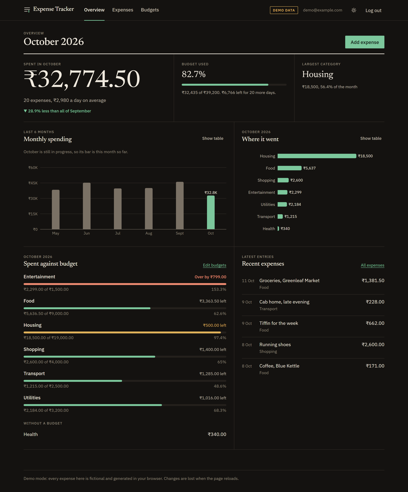

## The problem it solves

The Expense-Tracker-API is a complete backend, but a JSON API is hard to show to anyone and tedious to use day to day. This project is the missing half: a front end that covers every job the API was built for (auth, expenses with filters, budgets, summaries, CSV export) and that anyone can open and try in a minute, because demo mode needs nothing installed but Node.

## What it does

- **Register and log in.** Protected routes, and automatic logout when the token expires.
- **Dashboard.** This month's total, how much of the budget is used, spending per month for six months, spending per category, spent against budget per category, and the latest expenses.
- **Expenses.** A table with filters (search, category, date range, amount range, payment method), sorting, pagination, and add / edit / delete in a side panel with validation.
- **Budgets.** Set, change or remove a monthly budget per category, step through months, and copy last month's budgets into a new month.
- **CSV export** of whatever the filters currently show.
- **Loading, empty and error states** on every screen, keyboard access throughout, and a layout that works down to a 360px phone.
- **Dark theme by default**, with a designed light theme behind a toggle.

## Screenshots

All of these are real captures of the running app in demo mode, taken by `npm run screenshots` on 11 October 2026. The expenses in them are fictional.

| Dark (default)                                                | Light                                                           |
| ------------------------------------------------------------- | --------------------------------------------------------------- |
|  | 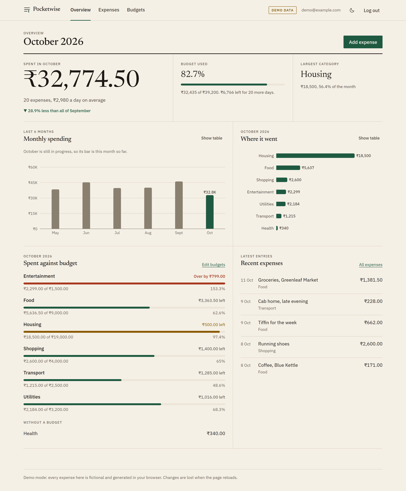 |
| 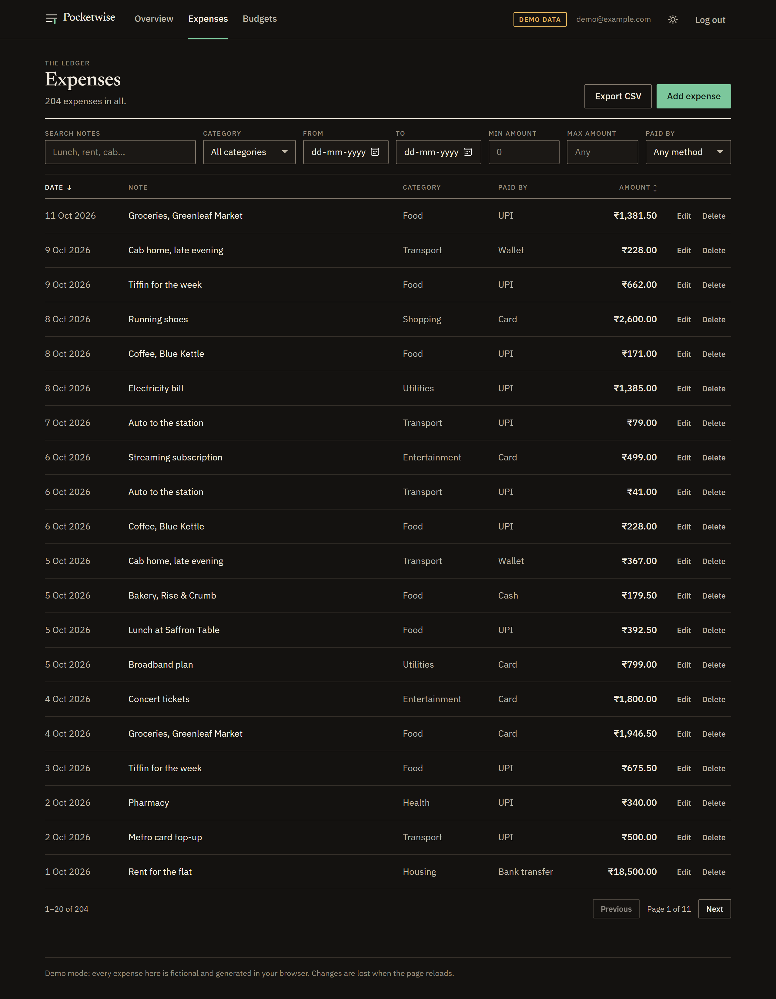   | 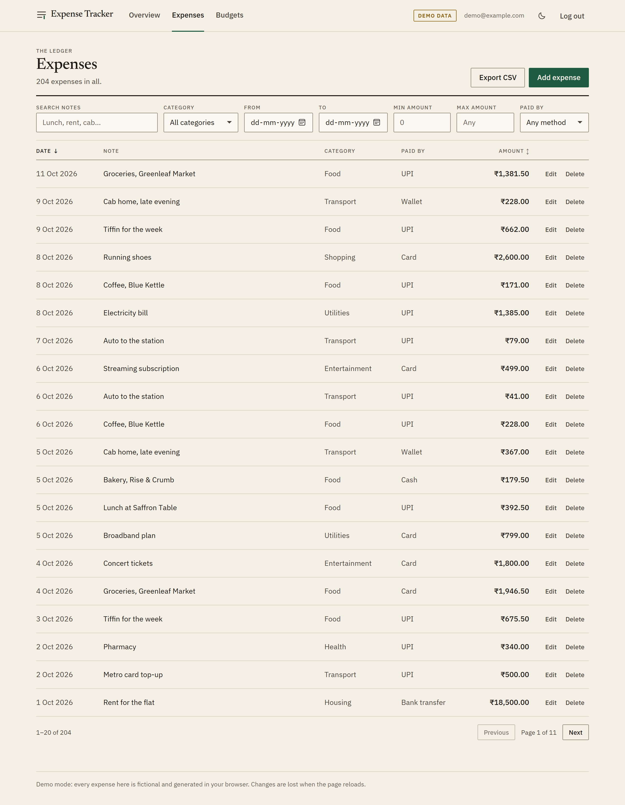   |
| 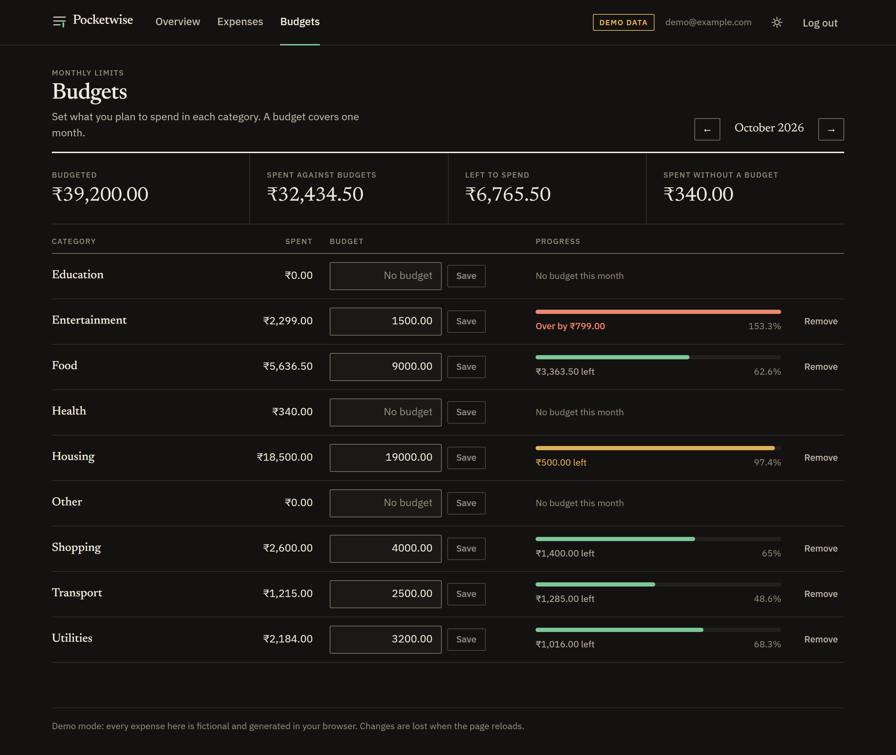     | 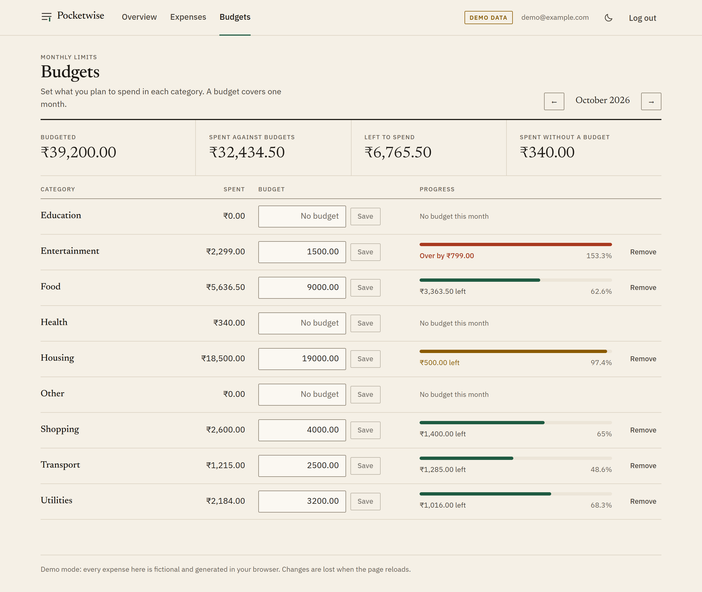     |

| Adding an expense                                                      | Login                                                                     |
| ---------------------------------------------------------------------- | ------------------------------------------------------------------------- |
| 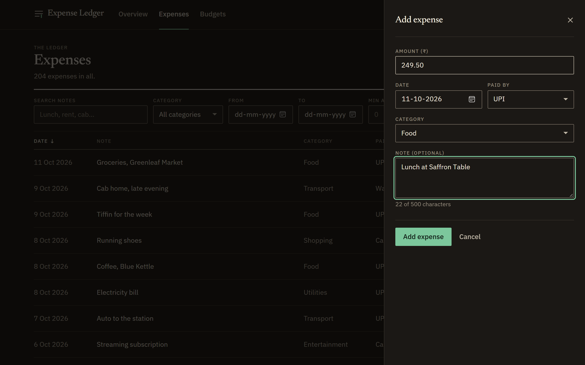 | 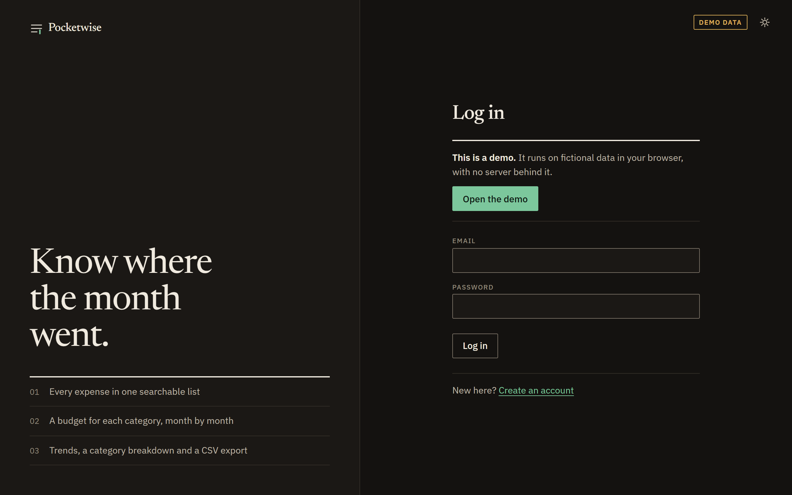 |

On a phone (390px wide):

| Dashboard                                                                                    | Expenses                                                                                   |
| -------------------------------------------------------------------------------------------- | ------------------------------------------------------------------------------------------ |
| 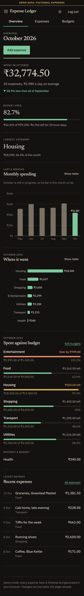 | 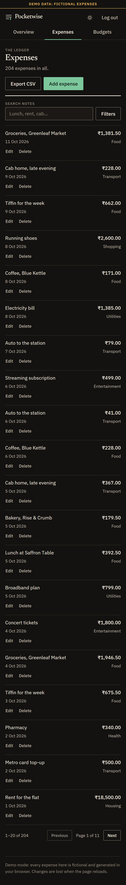 |

## Run it

You need **Node 20.19+ or 22.12+** (built and tested on Node 22.16.0, npm 10.9.2, Windows 11).

```bash
git clone https://github.com/Omkar210404/price-expense-tracker.git
cd price-expense-tracker
npm install
```

### Demo mode (no backend)

```bash
npm run dev:demo
```

Open <http://localhost:5173> and press **Open the demo**. That is all.

Demo mode is switched on by `VITE_DEMO=true` (set for you by the committed `.env.demo`). A "Demo data" badge stays on screen the whole time. The data lives in the page's memory, so anything you add or change is gone after a reload.

### Normal mode (your own Expense-Tracker-API)

1. Start the API as its own README describes (`alembic upgrade head`, then `uvicorn app.main:app`). In **the API's** `.env`, allow this app's origin, or the browser will block every request:

   ```
   CORS_ORIGINS=http://localhost:5173
   ```

2. Tell this app where the API is:

   ```bash
   cp .env.example .env.local      # Windows: copy .env.example .env.local
   ```

   Then set `VITE_API_URL` in `.env.local` (for example `http://localhost:8000`) and leave `VITE_DEMO=false`.

3. Start the app:

   ```bash
   npm run dev
   ```

If `VITE_API_URL` is missing, the app shows a page that says so instead of failing on the first request.

| Variable        | Needed         | Default | What it does                                                                |
| --------------- | -------------- | ------- | --------------------------------------------------------------------------- |
| `VITE_API_URL`  | in normal mode | none    | Base URL of the API, without a trailing slash                               |
| `VITE_DEMO`     | no             | `false` | `true` runs on in-browser demo data and ignores `VITE_API_URL`              |
| `VITE_CURRENCY` | no             | `INR`   | ISO 4217 code used to format amounts. Display only: the API has no currency |

Every `VITE_` variable ends up in the built JavaScript, so none of them may hold a secret. There are no URLs or secrets in the code.

### All commands

| Command                                                       | What it does                                                    |
| ------------------------------------------------------------- | --------------------------------------------------------------- |
| `npm run dev`                                                 | Dev server in normal mode                                       |
| `npm run dev:demo`                                            | Dev server in demo mode                                         |
| `npm run build` / `npm run build:demo`                        | Production build, normal or demo                                |
| `npm run preview`                                             | Serve the last build                                            |
| `npm test`                                                    | Run the tests once                                              |
| `npm run test:contract`                                       | Compare the demo layer with a real API (see [Tests](#tests))    |
| `npm run lint` / `npm run typecheck` / `npm run format:check` | The checks CI runs                                              |
| `npm run screenshots`                                         | Re-take the README screenshots (needs Edge or Chrome installed) |

## How it works

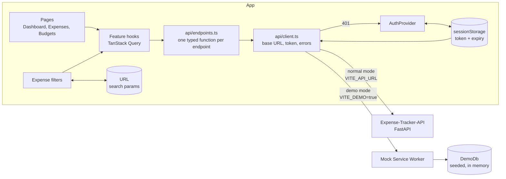

- **One API client.** `src/api/client.ts` is the only code that calls `fetch`. It adds the base URL and the bearer token, builds query strings, and turns every failure into an `ApiError` carrying the API's own `code`, `message` and per-field `details`.
- **Types written from the backend.** `src/api/types.ts` mirrors the API's Pydantic schemas field for field, and each block names the Python file it comes from. Money stays a string (`"249.50"`) end to end, as the API sends it. Any arithmetic converts to whole paise first, so no total is ever a float sum.
- **Server state in TanStack Query.** Adding, editing or deleting anything refreshes the list, the budgets and the summaries together, because one new expense changes all three.
- **Filters live in the URL.** `?q=rent&category=3&page=2` survives a reload, works with the back button and can be shared. A reversed date or amount range is caught before any request is sent.
- **The API does the sums.** Spent, remaining, percent used and over-budget all come from `GET /budgets/status`. The app displays them; it does not recompute them.

### Logging in, and where the token is kept

The API issues a JWT that lasts 30 minutes by default. It has no refresh token and no logout endpoint, and it does not use cookies. That limits the choices:

| Where                            | Survives a reload                 | Shared across tabs | Readable by a script on the page                                    |
| -------------------------------- | --------------------------------- | ------------------ | ------------------------------------------------------------------- |
| Memory only                      | no                                | no                 | harder to reach, but a script on the page can still use the session |
| **`sessionStorage`** (used here) | **yes**                           | no                 | yes                                                                 |
| `localStorage`                   | yes, and after the browser closes | yes                | yes                                                                 |

I chose **`sessionStorage`**. Memory only is the strictest, but with no refresh token it would mean logging in again after every page reload. `localStorage` keeps a token around after the tab is closed, for no benefit when the token dies in 30 minutes anyway. `sessionStorage` is the middle: it survives a reload and is gone when the tab closes.

It is **not** a defence against cross-site scripting. A script injected into the page can read `sessionStorage` exactly as it can read `localStorage`. What protects the token is not letting scripts in: the app renders everything through React (no `dangerouslySetInnerHTML` anywhere) and loads no third-party scripts or fonts. The real fix, an `httpOnly` cookie with a refresh token, needs changes to the API and is listed under [future ideas](#future-ideas). The storage choice is isolated in `src/auth/tokenStore.ts`, so changing it is a one-file change.

**Automatic logout** has three triggers, all ending in the same place (token cleared, cached data cleared, login page with "Your session expired"):

1. a timer set from the login's `expires_in`;
2. a re-check whenever the tab becomes visible or focused, because browsers hold timers back in background tabs;
3. any `401` from the API on a request that carried the token.

Registering logs you in straight away: the API's register call returns no token, so the app follows it with a login.

### Demo mode

Demo mode uses [Mock Service Worker](https://mswjs.io/) to answer the app's requests inside the browser. I chose it over a mock adapter inside the API client because the real client then runs unchanged in demo mode: the same headers, the same error parsing, the same 401 handling. The same handlers also serve the tests.

- `src/demo/db.ts` re-implements the backend's rules in TypeScript: filters, sorting, pagination, budget status, summaries, validation errors and conflicts.
- `src/demo/seed.ts` fills it with six months of **fictional** expenses for one made-up account, generated from a fixed seed and dated relative to today, so "this month" is never empty. Every name and shop in it is invented.
- The badge **Demo data** is always visible when demo mode is on (a strip across the top on phones), and the login screen says what the demo is.
- **A normal build contains none of it.** The demo layer is loaded with a dynamic import behind a build-time flag, and the mock worker file is removed from normal builds. I checked the output: a normal `dist/` has no `mockServiceWorker.js` and none of the seed data.

Because the demo layer is a re-implementation, it could drift from the real API. `npm run test:contract` guards against that: see [Tests](#tests).

## Design decisions

The full rules are in [DESIGN.md](DESIGN.md), written before any screen was built. In short:

- **A ledger, not an admin template.** Pages are ruled, not boxed: no cards, shadows or gradients. The dashboard is a bento grid whose cells are divided by hairline rules.
- **One accent colour** (a ledger green) for actions and data. Amber and brick red appear only as budget status, and always with words beside them ("Over by ₹799.00"), never as colour alone.
- **Dark by default, light as a designed variant.** Both palettes are warm (ink and paper), and every text and border colour's contrast ratio was computed, not eyeballed. The table is in DESIGN.md.
- **Type: Newsreader for headings and large numbers, IBM Plex Sans for the interface.** Every money value uses tabular numerals so columns line up. The first choice of serif, Fraunces, turned out to have no tabular figures when I measured it in the browser, so I measured six candidates and switched. Fonts are self-hosted; the app makes no request to a font CDN.
- **CSS Modules with CSS custom properties, not Tailwind.** The design is a small set of tokens plus a few bespoke components. With tokens as custom properties the light theme is a token swap, CSS Modules come with Vite, and there is no pull towards a default utility-class look.
- **Charts chosen by what the data is.** Monthly totals are columns, not a line, because the current month is unfinished and a line would draw a false drop. Categories are ranked bars, not a pie. Only the month in progress is green. Every chart has a "Show table" switch, so nothing is readable only by hovering.
- **Motion only where it means something:** the month total counts up and the bars grow, once, on load. Both are off under `prefers-reduced-motion`.
- **Native `<dialog>`** for the side panel and the delete confirmation, so the focus trap, Esc and focus return come from the browser.

## Project structure

```
src/
├─ api/            the typed client: client.ts, endpoints.ts, types.ts, errors.ts, query keys
├─ auth/           AuthProvider, tokenStore, session expiry, login and register pages, ProtectedRoute
├─ demo/           DEMO ONLY: in-memory API rules, MSW handlers, seed data, contract test
├─ features/
│  ├─ dashboard/   bento grid, figures, the two charts, data shaping
│  ├─ expenses/    filters (URL state), table, form panel, delete dialog, export
│  └─ budgets/     budget rows, month picker, copy from last month
├─ layout/         masthead, page header, demo badge, missing-config page
├─ lib/            money, dates, motion, download
├─ styles/         tokens.css (both themes), base.css
├─ theme/          theme provider and toggle
├─ ui/             shared pieces: Button, Field, Dialog, Meter, Money, states, toasts
└─ test/           test setup, the fake API server, a render helper
scripts/screenshots.mjs   takes the README screenshots from the demo build
DESIGN.md                 palette, type, spacing and component rules
PLAN.md                   the plan the build followed
```

## Tests

Vitest and React Testing Library. Component tests render the whole app against the demo handlers running in Node, so they exercise the real client, router and cache.

```bash
npm test
```

Result of the last run on my machine: **186 tests passed in 17 files, 1 skipped** (the contract test, which needs a real API).

| Area                | What is checked                                                                                                                            |
| ------------------- | ------------------------------------------------------------------------------------------------------------------------------------------ |
| Auth flow           | login, wrong password, client-side checks, register then auto-login, duplicate email, protected routes, and all three logout triggers      |
| Filters             | URL round trip, tampered values dropped, page reset on change, debounced search sends one request, reversed ranges blocked with no request |
| Expense form        | every validation rule, PATCH sends only changed fields, the API's 422 lands under the right field                                          |
| Expenses page       | loading, empty (new account and no matches), error with retry, pagination, sorting, add, edit, delete with confirmation, CSV export        |
| Budgets             | create uses POST and change uses PATCH, invalid amounts, remove, the API's 409 message, months, copy from last month                       |
| Budget calculations | meter states at the 85% and 100% boundaries, "left" versus "over by", rows for budgeted and unbudgeted categories                          |
| Dashboard           | totals match the API, per-category progress, both chart tables, one failed region does not take down the rest, empty account               |
| API client          | error body to `ApiError`, non-JSON errors, network failure, form-encoded login, token header, 401 reporting                                |
| Money and dates     | string to paise and back with no float drift, month arithmetic, leap years                                                                 |
| Demo layer          | budget status, trends, summaries, filters, CSV escaping, and tokens, each against the backend's documented rules                           |

### Checked against the real API

Two things were run against a real Expense-Tracker-API (commit `8891cc1`, started locally on a fresh database), not only against mocks:

- **Contract test.** `npm run test:contract` sends the same 55 requests to the demo layer and to the real API, and compares every status and body. All 55 match. It needs a running API with an empty database:

  ```bash
  VITE_REAL_API_URL=http://127.0.0.1:8000 npm run test:contract
  # PowerShell: $env:VITE_REAL_API_URL = "http://127.0.0.1:8000"; npm run test:contract
  ```

- **Browser run of the normal build.** I drove a normal-mode build in Edge against the real API: register, add and edit expenses, filter, export a CSV, create and change a budget, and read the dashboard. With the API set to issue 60-second tokens, the app logged itself out 60.3 seconds after registering and showed the expiry notice. A tampered token was rejected by the API and also logged the app out.

I also checked in a real browser, in demo mode: no sideways scrolling at 360px on any screen, the skip link, opening and closing the panel by keyboard with focus trapped inside and returned afterwards, adding an expense with the keyboard, the theme surviving a reload, and that both fonts render tabular digits.

**Not checked:** browsers other than Edge (Chromium), a real screen reader, and the GitHub Actions run itself, which only happens once the repository is pushed.

## Limitations

- **The token is readable by scripts on the page** (see above). This is a limit of an API without cookies and refresh tokens, not something the front end can fix alone.
- **No category management.** The API can add, rename and delete categories; this app only uses the ones that exist. A new account gets the API's nine defaults.
- **Search covers notes only**, because that is what the API's `q` parameter searches.
- **You are logged out every 30 minutes** (or whatever the API is set to). There is no refresh token to extend a session, and no warning before it ends.
- **Month boundaries and time zones.** "This month" is the browser's local month. The API's trends use UTC. For a few hours around the end of a month they can disagree; when they do, the "compared with last month" line is hidden instead of showing a wrong number.
- **One currency.** `VITE_CURRENCY` only changes how amounts are formatted.
- **Demo data resets on reload**, and the demo layer is a re-implementation of the API. The contract test covers 55 requests, not every possible one.
- **The dashboard always shows the current month.** Older months are visible on the Budgets page and through the expense filters.
- **The dashboard's JavaScript chunk is large** because of the charting library: 372 kB (107 kB gzipped) on top of a 313 kB (99 kB gzipped) main bundle. It is loaded only when the dashboard opens.
- **Tested in one browser.** Everything was checked in Edge. The native `<dialog>` and CSS used here are supported by current Firefox and Safari, but I have not run them.

## Future ideas

- A categories page: add, rename, delete.
- With API changes: an `httpOnly` cookie plus a refresh token, and a real logout.
- A warning shortly before the session ends.
- A month switcher on the dashboard.
- Budgets that repeat every month until changed.
- An end-to-end test suite in CI, and runs in Firefox and Safari.

## License

[MIT](LICENSE)
